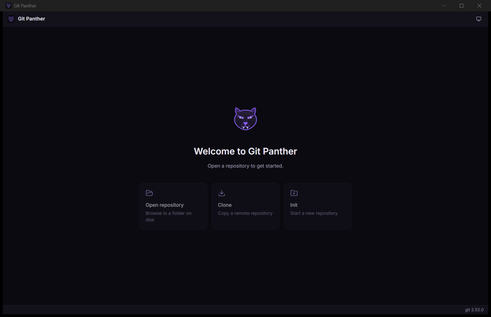
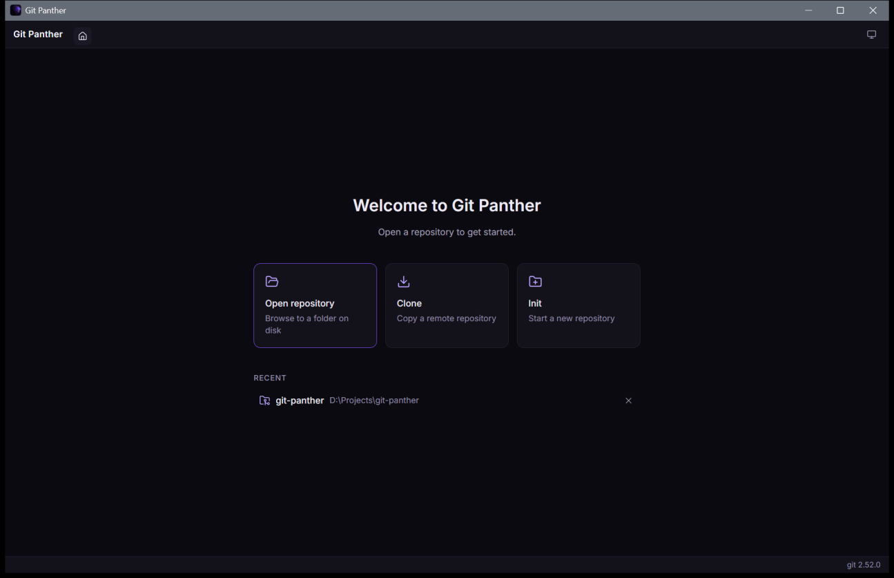
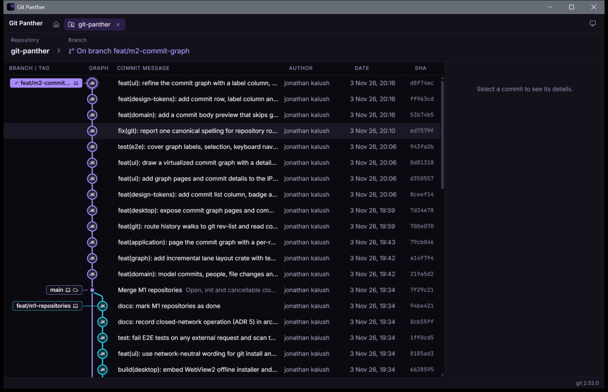

# Git Panther — Roadmap

Git Panther must work fully on closed networks ([ADR 5](adr/0005-closed-network-operation.md)); every item below respects that.

Each milestone is developed on its own branch with small Conventional Commits, ends with a demo and your approval, and is merged to `main` only after that. Ship target for the MVP is **Windows**; CI builds on Windows, macOS and Linux.

Status legend: ✅ done · 🚧 in progress · ⏳ planned

## MVP

### ✅ M0 — Foundation

- Toolchain (Rust stable, Node, pnpm), repo, `.gitignore`, Conventional Commits
- Project skills: `clean-code`, `solid`, `design-system`
- `ARCHITECTURE.md`, `ROADMAP.md`, ADRs
- Cargo workspace (domain, application, git crates; `panther-graph` arrives with M2) + Tauri 2 app + pnpm workspace
- Lint/format (clippy, rustfmt, ESLint + boundaries, Prettier), strict TS, architecture test
- specta-generated IPC bindings, `AppError`, git-on-PATH check
- Design tokens package, dark/light/system theming, app shell with empty state
- GitHub Actions CI (lint, test, build on 3 OSes)

**Demo:** the app launches, shows the Git Panther shell, detects git, switches themes; `pnpm check` is green.

Open items carried forward: the `tauri-driver` smoke test of the real window moves to M7 (E2E currently drives the UI in a browser with mocked IPC), and the CI workflow has not run yet because the repo has no remote.

### ✅ M1 — Repositories

Open / init / clone (with progress, cancellable), repo tabs, recent repositories, file watcher.

**Demo:** open, init or clone from the start page; each repository opens in a persisted tab showing its current branch; recent repositories are remembered across restarts; external changes refresh the tab.

### ✅ M2 — Commit graph

Paged log, incremental lane layout (`panther-graph`) with benchmarks, canvas graph + virtualized list, commit details panel, 100k-commit fixture.

**Demo:** history renders as a lane graph with author-initial nodes, a Branch / Tag column joined to each commit, body previews, keyboard navigation and a details panel; optional columns (Author, Date / Time, SHA) are chosen from the column menu. On a generated 100k-commit repository the first page appears in ~0.4 s (~0.63 s without a commit-graph file) and later pages in ~22 ms.

### ✅ M3 — Working tree & diffs

Status, stage/unstage file and hunk, discard, commit / amend, unified and split diff viewer with word highlights.

**Demo:** a "// Working copy" row above the graph opens the staging panel; files open a unified or split diff with word highlights and per-hunk Stage / Unstage / Discard; commits run through the git CLI so hooks and signing apply; commit details open per-commit file diffs.

### ✅ M4 — Branches

Create, checkout, rename, delete; sidebar tree; graph context menus.

**Demo:** the sidebar groups local and remote branches into folders with a filter, ahead/behind badges and the checked-out branch; double-click switches (remote branches get a tracking branch); right-click on branches or commits creates, renames, deletes or checks out. Changes run through `git switch` / `git branch`, so hooks and git's safety checks apply.

### ✅ M5 — Remotes

Fetch, pull (ff / merge / rebase setting), push with progress; ahead/behind badges; clear auth error surfaces.

**Demo:** the repository header has Fetch, Pull (fast-forward only, merge or rebase; the choice is remembered) and Push with live progress, Cancel, and the current branch's to-pull / to-push counts. The first push of a branch sets its upstream. Network operations run through the git CLI with the user's own credential helpers and SSH keys; authentication, network, rejected-push, diverged-pull, conflict and missing-upstream failures each get their own explanation.

### ✅ M6 — Stash & conflicts

Stash save / apply / pop / drop; basic conflict view (take ours / theirs / mark resolved).

**Demo:** Stash and Pop sit in the repository header; the stash dialog takes an optional message and can leave new files behind. The sidebar lists stashes with Apply / Pop / Drop (confirmed); a conflicting pop keeps its entry. When a merge, rebase, cherry-pick or revert stops on conflicts, the working-copy panel lists each file with Keep mine / Take incoming / Mark resolved, then Continue or Abort (confirmed). "Mine" and "incoming" stay correct during a rebase, where git's ours and theirs swap.

### ✅ M7 — Settings & release

Settings screen (theme, git path, pull mode, fonts), E2E flows, self-contained Windows installer (NSIS/MSI, embedded WebView2 offline installer) from CI, verified on a machine without internet.

**Demo:** Settings (title bar gear, or "Choose git…" when git is missing) sets theme, interface size, code font, pull strategy and the git executable; a git path is checked before saving and offers a restart. The Release workflow builds NSIS and MSI installers (~210 MB each, WebView2 offline installer embedded) and fails if one is too small to be self-contained. Manual closed-network checks are in [Offline verification](OFFLINE-VERIFICATION.md); they still need running on an offline machine.

### ✅ Sign-in to HTTPS git servers

Sign in to self-hosted servers (e.g. GitLab) with a personal number and password from Settings, a refused sync or a refused clone. Passwords go to Git Credential Manager; Git Panther stores only server and user name, and verifies against the repository's remote before keeping them.

### ✅ M8 — Graph actions

Merge, rebase, cherry-pick, revert, reset (soft / mixed / hard), check out a commit, create / delete / push tags, drag a branch onto the checked-out one, and undo.

**Demo:** right-click a commit or branch for every action; a hard reset asks first. Dropping a branch on the checked-out one offers merge or rebase. Undo (button or Ctrl+Z) reverts the last commit, amend, checkout, pull, merge, rebase, cherry-pick, revert, reset or branch deletion, keeps uncommitted work, and refuses if HEAD moved since.

### ✅ M9 — Finding things

Search commits (message, author, SHA), hide / solo branches, file history and blame, line-level staging.

**Demo:** Ctrl+F searches the graph by message, author or SHA prefix with next / previous; branches can be hidden or shown alone from their menu (remembered per repository). In the diff view, + / − signs pick single lines to stage, unstage or discard; History and Blame open per file, and clicking a commit opens its diff of that file.

### ✅ M10 — Editing history

Interactive rebase (reorder, squash, reword, drop) and a 3-way conflict editor.

**Demo:** "Interactive rebase of later commits…" on any commit opens a plan of the commits after it, oldest first, to reorder, reword, squash, fix up or drop; it runs through `git rebase -i` without ever opening an editor and can be undone. Clicking a conflicted file opens the conflict editor: each conflict shows mine and incoming side by side with use mine / incoming / both, and an editable result that is saved and staged in one step.

### ⏳ M11 — Remotes and repository types

Add / edit / remove remotes, force push with lease, delete remote branches, push to another remote; submodules, Git LFS, worktrees.

### ⏳ M12 — Workflow

Command palette, configurable keyboard shortcuts, git identity profiles, commit signing settings.

### ⏳ M13 — Hosting

Pull requests and issues for self-hosted GitHub Enterprise Server, GitLab self-managed, Bitbucket Data Center and Azure DevOps Server.

## Later (to be prioritised together)

- Interactive rebase (drag-and-drop)
- Cherry-pick, revert, reset from the graph
- 3-way merge-conflict editor
- Blame and file history
- Tags, submodules, Git LFS
- SSH / GPG key management, in-app credentials
- Pull-request integration via `HostingProvider` for self-hosted servers (GitHub Enterprise Server, GitLab self-managed, Bitbucket Data Center, Azure DevOps Server) with configurable URLs and custom CA certificates
- Workspaces, undo/redo of git actions
- Command palette, configurable keyboard shortcuts
- Updates from an internal update server (no public update checks), macOS/Linux installers and signing
